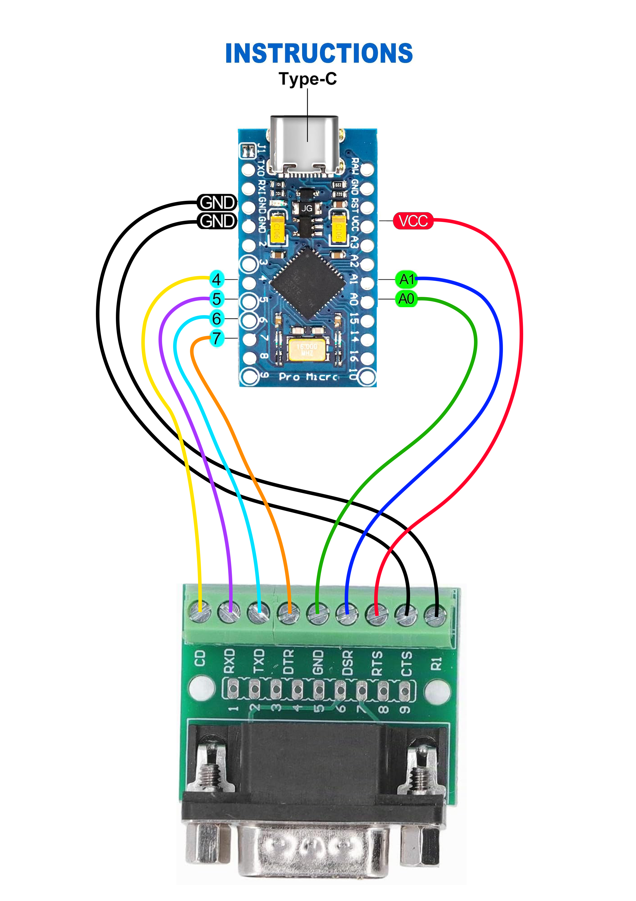

# Vectrex Controller to USB

Use an original Vectrex controller on a modern PC. A small adapter turns it
into a plain USB game controller with two analog axes and four buttons. No
drivers, no software on the PC: Windows, Linux and macOS see a standard
HID gamepad, so it works in emulators and in any game that accepts a joystick.

<a href="DB9_TO_ATMega32U4.png"></a>

*Click the picture for the full-size wiring diagram.*

## What you need

- A **Pro Micro** or **Arduino Micro** board: ATmega32U4, 5 V, 16 MHz, with
  the usual Caterina USB bootloader. A USB Type-C variant is handy
  ([example, 4-pack](https://www.amazon.de/dp/B0F2DVPVLB)).
- A **DB9 breakout** with screw terminals, so the Vectrex plug goes straight
  in ([example](https://www.amazon.de/dp/B0B1DKG78C)).
- Nine short wires and a USB data cable.

## Wiring

Go by the DB9 pin numbers printed on the breakout. The RS-232 names next to
them are meaningless here (the terminal labelled GND is the X axis, not
ground).

| DB9 pin | Breakout label | Vectrex signal | Board pin |
| ------: | -------------- | -------------- | --------- |
| 1       | CD             | Button 1       | D4        |
| 2       | RXD            | Button 2       | D5        |
| 3       | TXD            | Button 3       | D6        |
| 4       | DTR            | Button 4       | D7        |
| 5       | GND            | X axis         | A0        |
| 6       | DSR            | Y axis         | A1        |
| 7       | RTS            | +5 V           | VCC       |
| 8       | CTS            | Ground         | GND       |
| 9       | RI             | -5 V           | GND       |

The Vectrex console feeds the stick's potentiometers from +5 V and -5 V.
The adapter ties the -5 V pin to ground instead, so the pots run from 0 to
5 V and the board's analog inputs can read them directly. Never connect the
adapter to a controller that is also plugged into a powered Vectrex.

## How it works

The board samples the two pots about 1000 times a second and reads the four
buttons, which short to ground when pressed. It maps each axis through a
stored calibration (rest position, end stops, dead zone, direction) and sends
a standard USB HID gamepad report 250 times a second. The calibration lives
in the board's EEPROM, so an adapter keeps its settings when moved to another
PC. A new board uses built-in defaults measured on a reference controller;
you can recenter or fully calibrate it for your own controller at any time.

## Flashing

**Easy way, Windows:** download the package from the [latest release](../../releases/latest), extract it, connect the
board and double-click `Flash.bat`. It resets the board, programs it and
verifies. `Recenter.bat` saves your stick's rest position to the board.

**From source:** install [PlatformIO](https://platformio.org/), then in the
project folder:

```powershell
pio run -e hid -t upload
```

PlatformIO performs the 1200-baud reset into the bootloader by itself. On a
Pro Micro clone that does not auto-reset, briefly short RST to GND twice when
the upload starts waiting for the port.

## Calibrating

With the controller connected, run the guided tool and follow the prompts
(rest position, each end stop, a perimeter sweep, the buttons):

```powershell
py -m pip install -r scripts/requirements.txt
py scripts/calibrate.py
```

It writes the result to the board's EEPROM and verifies it. To only fix an
off-center rest position, use `py scripts/select_profile.py --recenter`; to
go back to the built-in defaults, `py scripts/select_profile.py --stock`.

## More details

[docs/DEVELOPMENT.md](docs/DEVELOPMENT.md) has the full story: the measured
controller study behind the default profile, the raw serial protocol and
EEPROM layout, the Windows release package build, and the verification steps.

For the detailed design history, read
[Design and validation](docs/DESIGN_AND_VALIDATION.md): the five-controller
measurements, real-console tests, and how we selected the 75% range and
±20-count dead zone. [Project handover](docs/HANDOVER.md) covers the repository,
maintenance commands, evidence and release workflow.

## License

[MIT](LICENSE): free to use, modify and redistribute, with attribution. The
Windows package bundles AVRDUDE, which keeps its own license.
