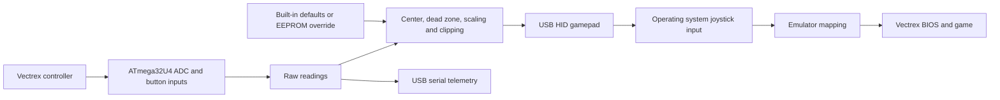
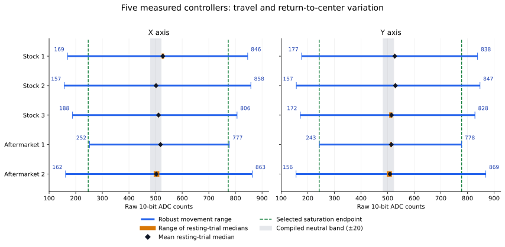
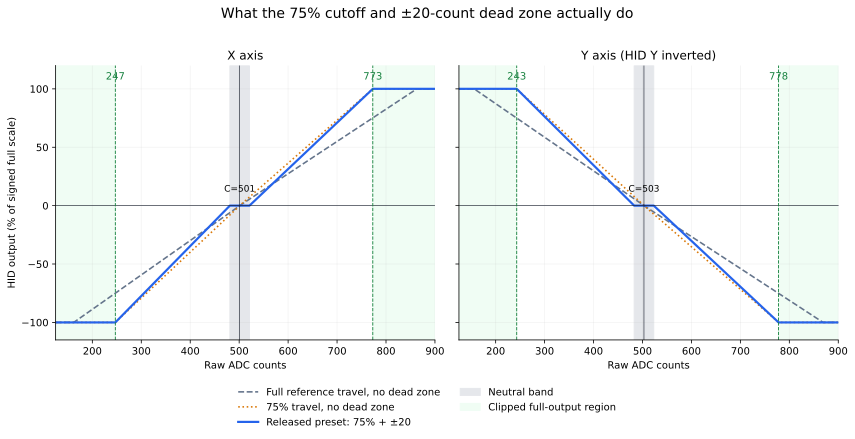

# Designing a Vectrex controller adapter for emulator development

This is the design history and evidence behind Vectrex Controller to USB.
It explains why the firmware reaches full output before the joystick's
mechanical stops, how the controller study was conducted, and why the final
preset combines a 75% range with a 20-count dead zone.

Prepared for the v1.0.0 project handover on 2026-10-23. The hardware study and
response-profile decisions were made on 2026-10-11; portable packaging was
tested on 2026-10-13. The final straight button wiring is documented in the
2026-10-23 release. The authoritative implementation is in
[adapter.h](../firmware/common/adapter.h), with selected defaults in
[firmware_defaults.json](../calibration/firmware_defaults.json).

## 1. The problem we wanted to solve

The purpose was to use a real Vectrex controller while developing and testing
Vectrex games on a PC emulator. Recognizing four buttons and two axes was
only the first requirement. The useful travel and resting behavior also
needed to feel reasonably close to the owner's real console.

A calibration that maps the joystick's entire mechanical travel to the USB
axis range can feel different if the console already reports full analog
deflection earlier in that travel. The project therefore separates three
quantities:

| Quantity | What it describes | How it was observed |
| --- | --- | --- |
| Mechanical travel | Where the stick physically stops | Directional holds and perimeter sweeps |
| Electrical output | Potentiometer output as read by this adapter | Raw 10-bit ADC samples |
| Effective game input | What the BIOS, emulator and game receive | HID/Windows captures and controller test ROM |

The delivered response is a practical preset for this development setup.
It is not a laboratory-derived electrical model of every Vectrex console.

## 2. Hardware and the single-supply arrangement

The prototype used a 5 V, 16 MHz ATmega32U4 board identified by the toolchain
as an Arduino Micro. Its AVR signature was `0x1e9587`. A DB9 screw-terminal
breakout provided access to the controller signals. The ATmega32U4 was chosen
because it can expose native USB HID and a USB serial maintenance interface
without a second USB-to-serial microcontroller.

The supported build target is `micro`, with the Caterina/AVR109 bootloader.
Compatible Pro Micro boards need the same clock, supply voltage and pin
mapping. The physically tested board was the Arduino Micro; support for
other compatible boards is not equivalent to a separate hardware test of
each clone. An Uno or ATmega328P Nano is not a substitute for this firmware.

The console normally supplies the joystick circuitry with positive and
negative rails. This adapter instead connects the controller's negative
rail to ground and supplies its positive rail from the board's 5 V VCC.
The controller is powered by the adapter, not by the console. On the tested
controllers this allowed the two potentiometer outputs to remain inside the
Arduino's input range and be read directly by A0/A1.

| DB9 pin | Signal in this project | Current board connection |
| ---: | --- | --- |
| 1 | Button 1 | D4 |
| 2 | Button 2 | D5 |
| 3 | Button 3 | D6 |
| 4 | Button 4 | D7 |
| 5 | Joystick X output | A0 |
| 6 | Joystick Y output | A1 |
| 7 | Positive controller supply | VCC, 5 V |
| 8 | Controller ground | GND |
| 9 | Negative controller rail, grounded in this adapter | GND |

Use DB9 pin numbers. RS-232 breakout labels do not describe Vectrex signals:
the terminal marked **GND** can be DB9 pin 5, which is the X output.
The [wiring drawing](../DB9_TO_ATMega32U4.png) and current
[README](../README.md#wiring) describe the released arrangement.

Before connecting the analog outputs, the owner measured their voltages
over the full travel and confirmed that they stayed within the ADC supply
range. Another builder must check their own hardware. This firmware cannot
protect an analog pin from negative voltage or overvoltage, and the adapter
must not be connected to a controller simultaneously powered by a Vectrex.

Raw ADC counts from this single-supply arrangement are not direct
measurements of the voltages present when the same controller is powered by
the console. Supply voltage, reference voltage and any controller electronics
matter. The study did not establish an exact conversion between those two
electrical environments.

## 3. Firmware architecture



There are two small build entry points using the same common implementation:

- `hid`: the USB gamepad and serial maintenance interface.
- `calibration`: serial diagnostics without the HID gamepad collection.

The HID build can also be calibrated directly; flashing the diagnostic
build is not required for normal recentering.

| Function | Implemented schedule or behavior |
| --- | --- |
| ADC and button sampling | Approximately once every 1 ms |
| HID report scheduling | Once every 4 ms, nominally 250 Hz |
| Raw serial telemetry | Approximately every 10 ms while CDC is open and has room |
| Button debounce | Each transition requires 5 ms of stable input |
| Default smoothing | Disabled |
| Optional smoothing | Fixed-point one-quarter IIR update per sample |

These are firmware schedules, not measured input-to-photon latency. USB
scheduling, operating-system delivery, emulator polling and display timing
add their own delays. No oscilloscope or high-speed-camera latency result
was established by this project.

The HID gamepad uses report ID 3 and sends two signed little-endian 16-bit
axis values, four button bits and four padding bits. The axis limits are
`-32767..+32767`. Although the report uses 16-bit fields, the source ADC has
10-bit resolution: scaling does not create additional physical resolution.
Windows' joystick API presents the tested axes on a `0..65535` scale, with
neutral observed at `32767`.

The current release reads logical buttons 1–4 directly from D4–D7. During
the first hardware session, buttons 2 and 3 were corrected using a software
swap. The adapter was subsequently rewired and that swap was removed for
the release. Historical captures can therefore come from the earlier
mapping; they must not be used to change the current wiring table back.

## 4. Initial bring-up and individual calibration

The first work established that USB enumeration, raw analog reads, serial
commands and buttons worked before relying on a shared controller preset.
Disconnected ADC inputs were treated as floating inputs, not valid center
measurements. The first successful individual calibration used:

| Axis | Minimum | Center | Maximum | Dead zone |
| --- | ---: | ---: | ---: | ---: |
| X | 162 | 516 | 863 | 3 |
| Y | 156 | 498 | 869 | 3 |

Y was inverted and filtering was off. The calibration was saved and read
back from EEPROM before the HID firmware was flashed. The initial stationary
noise was zero ADC counts peak-to-peak on X and one on Y.

In the Windows motion/button capture, both axes reached `0..65535`; the
observed button masks included individual presses `1`, `2`, `4`, `8`, and
all four together `15`. That capture contained 4,478 samples.
Evidence: [initial calibration](../calibration/latest_calibration.json) and
[Windows motion/buttons](../calibration/hid_motion_buttons.json).
It established basic adapter operation, not the eventual shared response.

## 5. Measuring five controllers

The owner supplied three original controllers and two aftermarket
controllers. They were kept anonymous as stock 1–3 and aftermarket 1–2;
manufacturer-specific conclusions are not justified without reliable model
identification. Controllers were exchanged with USB power disconnected.

Each controller underwent the same sequence:

1. Leave the stick and all buttons untouched for 20 seconds.
2. Hold LEFT, RIGHT, UP and DOWN, normally for three seconds each.
3. Circle the complete perimeter for ten seconds, reaching every edge.
4. Release after the circles and capture five seconds of resting position.
5. Move fully LEFT, release, and capture another five seconds.
6. Move fully RIGHT, then fully UP, release, and capture five seconds.

The final return trial used sequential RIGHT then UP movement, not a
diagonal hold. This was clarified during the study. Stock 3 received extra
endpoint attention and five-second directional captures because its X holds
looked different from those of the other originals.

The serial telemetry is approximately 100 samples/second. Raw samples and
stage metadata were saved immediately, and the measurement tool did not
change EEPROM merely by recording a stage. Repeat measurements preserved
the previous capture rather than silently overwriting it.

Endpoints were estimated using the 0.5th and 99.5th percentiles of the
directional holds and perimeter readings. This reduces the influence of
isolated spikes. These are robust electrical movement ranges, not a claim
that every single sample remained inside them. The study center for each
controller is the mean of four resting-trial medians. Return spread is the
difference between the highest and lowest trial medians on that axis.

| Controller | X min / center / max | Y min / center / max | X / Y return spread |
| --- | --- | --- | --- |
| Stock 1 | 169 / 527.25 / 846 | 177 / 527.00 / 838 | 9 / 2 |
| Stock 2 | 157 / 501.75 / 858 | 157 / 529.25 / 847 | 2 / 3 |
| Stock 3 | 188 / 511.00 / 806 | 172 / 514.50 / 828 | 2 / 12 |
| Aftermarket 1 | 252 / 518.50 / 777 | 243 / 513.75 / 778 | 2 / 7 |
| Aftermarket 2 | 162 / 502.75 / 863 | 156 / 508.75 / 869 | 21 / 19 |

All numbers in this table are raw ADC counts, not signed HID codes or volts.
Sources: the five [controller records](../calibration/controller_study/)
and the original [comparison](../calibration/controller_study/comparison.md).



Three findings mattered:

- Aftermarket 1 had a consistently narrower range. Its spans were 525 X
  counts and 535 Y counts, compared with stock 2's 701 and 690.
- Aftermarket 2 had wide travel close to stock 2, but less consistent return
  positions. Low stationary noise did not mean good mechanical centering:
  its X and Y return spreads were 21 and 19 counts.
- Stock 3's held X endpoints were narrower and noisier than its perimeter
  range. This raised a question about wear, mechanics or holding position;
  it did not prove a broken potentiometer. A perimeter sweep was important
  because a cardinal hold alone did not describe its complete movement.

These are measurements from five individual controllers on one adapter.
They are useful engineering evidence, not a population survey.

## 6. Why we moved beyond averaged mechanical endpoints

The first shared default was an equal-weight average of the three original
controllers:

| Axis | Minimum | Center | Maximum | Dead zone |
| --- | ---: | ---: | ---: | ---: |
| X | 171 | 513 | 837 | 21 |
| Y | 169 | 524 | 838 | 20 |

The dead zones included observed inter-controller center differences and
return variation with margin. Aftermarket controllers were excluded from
that particular average. The historical file still calls this profile
`stock_defaults`; that label does not describe today's selected firmware
defaults.

This average treated broad physical travel as the desired full-scale
reference. Under it, aftermarket 1's held endpoints produced only about
75–80% output. That prompted a better question: was its range actually
insufficient on a real Vectrex, or was the USB calibration asking for more
travel than the console needed?

The owner suggested that aftermarket designers might have chosen a range
that already covered the console's usable input range. The subsequent work
tested the controller's behavior. It did not establish the designers'
intentions.

## 7. Testing through the console: PiTrex and the real cartridge

### PiTrex was useful, but its first numbers were misleading

The available PiTrex used a Raspberry Pi Zero WH. Two custom native ARM test
revisions produced a black screen even though the normal PiTrex menu worked.
No successful startup log or saved measurement established that the test
loop was running. Those failed attempts cannot be counted as analog data.

A standard 6809 test ROM then ran through the card's existing Exact emulator
and displayed controller values. Both stock 2 and aftermarket 1 appeared to
plateau at approximately `-60/+60` before their mechanical stops. Inspection
of the PiTrex source showed a digital joystick path that returns direction
multiplied by 60, while direct analog interception was conditional. The
installed launch was not established to exercise the intended analog path.
Consequently, those `±60` displays were excluded from native analog endpoint
evidence.

At the owner's request, the SD card was later restored: original boot
configuration and both menu loaders were verified against backups, and the
test additions were removed. The released adapter does not require PiTrex.

### A real cartridge removed that emulator layer

The owner's existing game-development cartridge used a W27C512 with PB6
selecting one of two 32 KB banks. A 64 KB test image was prepared with the
same 32 KB controller test in both halves, so bank selection could not
select different test code. It was programmed using XGPro and run directly
on the console without PiTrex.

The 6809 test called the original BIOS `Joy_Analog` routine at `$F1F5`.
Its display contained live X/Y, captured minimum/maximum, and a captured
center reference. Button 1 reset peaks, button 2 recorded the resting
reference, and button 4 froze or resumed peak recording. Capturing center
did not subtract it from the displayed live input. Readings were displayed
from RAM; there was no persistent measurement log.

The ROM was first exercised in a local CPU/VIA/BIOS model for signed extrema,
center capture, frozen peaks and continuing live movement. That software
test was useful for checking the program but did not replace physical
console testing.

The owner reported that **stock 2 and aftermarket 1 both reached
`-128..+127` on both axes on the real cartridge**. A supplied screen
photograph showed these extrema. The owner also observed that full output
occurred before the mechanical stops, at a broadly similar position to the
later emulator experiment.

This established that aftermarket 1's smaller Arduino span did not prevent
it reaching the full BIOS range on the tested console. It did not measure
the exact voltage at which saturation began, establish an exact mechanical
angle, or prove that all games use the same thresholds.
See the [native-console record](../calibration/controller_study/native_console_validation.md).
The historical test ROM sources and original screen photographs are not
part of the tracked adapter repository; they should be recovered and added
as a separate diagnostic artifact before claiming a fully reproducible
console-test package.

## 8. Establishing the ADC-to-HID-to-Windows mapping

Aftermarket 2 was selected as a broad-travel reference. Its endpoints were
X `162..863` and Y `156..869`. A fresh released-stick capture, rather than
the earlier multi-trial mean, established X=501 and Y=503 for this phase.
Firmware dead zones and filtering were set to zero while checking the
transfer mapping.

The recording tool collected raw ADC, direct HID reports and Windows
joystick output. The reads are close in time, not synchronized samples;
stationary endpoint holds were used to make comparison meaningful.

| Held direction | Raw ADC | Direct HID | Windows |
| --- | ---: | ---: | ---: |
| LEFT | X=162 | -32767 | 0 |
| RIGHT | X=863 | +32767 | 65535 |
| UP | Y=869 | -32767 | 0 |
| DOWN | Y=156 | +32767 | 65535 |

The Y sign reflects HID's configured inversion. The emulator interprets its
upward axis with the corresponding orientation. The verified holds are
recorded in [transfer_verification.json](../calibration/transfer_verification.json).

Early recordings were not all suitable as Windows transfer curves. One
capture interleaved uncalibrated WinMM requests that returned neutral
values. Another covered only LEFT because the requested movement sequence
was not fully captured. Those problems led to direct HID reads and
individual held-direction captures. Invalid or partial records were not
promoted into successful full-range verification.

## 9. The Windows calibration trap

The adapter already had Windows-side calibration from earlier work. That
introduced another transformation after firmware calibration. For this
specific device, the saved values were:

| Axis | Old signed minimum | Old center | Old maximum |
| --- | ---: | ---: | ---: |
| X | -24365 | 0 | +24670 |
| Y | -24575 | -891 | +24357 |

Those magnitudes are close to 75% of the HID range. The two axis overrides
were backed up and cleared, and fresh Windows readings then agreed with
direct HID. An already running emulator still showed Y around -4% when
both direct HID and fresh Windows reads were at neutral. Applying the old
Y calibration to HID zero predicts about -3.53% after axis inversion,
matching the rounded display. Fresh emulator input code returned zero;
fully closing and reopening the emulator resolved the discrepancy, as
confirmed by the owner.

This is why calibration needs to be managed as a complete path. The desired
release setup is firmware calibration, no extra Windows calibration, and
emulator dead zone 0% with endpoints 100%. Adding a second endpoint
compression can make full input occur too early.

The old Windows endpoints are also a significant qualification for the
threshold experiment below. Similar numbers in an emulator cannot by
themselves prove a real-console voltage threshold. See
[Windows mapping notes](../calibration/windows_mapping_notes.md) and the
[saved Windows calibration](../calibration/windows_calibration_before_reset.json).

## 10. How the 75% preset was chosen

The owner held aftermarket 2 where each **live** emulator axis first reached
its displayed limit, and the adapter values were captured for three seconds.
These were live readings, not the recorded peak column. The explicitly
reported RIGHT display was +126; the other directions were positioned using
the live-limit instruction without their numeric display values being
included in the replies.

| Direction | ADC observed | ADC median | HID median | Fraction of full HID magnitude |
| --- | --- | ---: | ---: | ---: |
| LEFT | 244–246 | 244 | -24841 | 75.8% |
| RIGHT | 773 | 773 | +24620 | 75.1% |
| UP | 777–778 | 778 | -24620 | 75.1% |
| DOWN | 244 | 244 | +24457 | 74.6% |

These positions were close to aftermarket 1's measured endpoints, X252–777
and Y243–778, and to the owner's approximate physical-position comparison
with the real console. That was useful supporting context. However, the
old Windows calibration was also numerically close to these HID values;
the emulator experiment was not an independent electrical measurement of
the console. The exact provenance of its additional scaling at capture time
was not instrumented.

The decisive engineering choice was therefore explicit: **use 75% of
aftermarket 2's measured center-to-endpoint travel as a shared early-saturation
preset**, then evaluate the feel in the intended emulator. The owner accepted
the resulting behavior. This was not calculated as a statistical confidence
limit or presented as a universal property of Vectrex hardware.
Raw captures and qualifications remain in
[emulator_thresholds.json](../calibration/controller_study/emulator_thresholds.json).

### Exact calculation

For reference center `C` and measured endpoint `E`:

```text
new_endpoint = round_half_up(C + 0.75 * (E - C))
```

The negative and positive halves are calculated independently to preserve
asymmetry. The center is not multiplied by 0.75, nor are the absolute ADC
minimum and maximum simply multiplied by 0.75.

| Axis/edge | Calculation | Rounded endpoint |
| --- | --- | ---: |
| X minimum | 501 + 0.75 × (162 − 501) = 246.75 | 247 |
| X maximum | 501 + 0.75 × (863 − 501) = 772.50 | 773 |
| Y minimum | 503 + 0.75 × (156 − 503) = 242.75 | 243 |
| Y maximum | 503 + 0.75 × (869 − 503) = 777.50 | 778 |

The firmware maps these new endpoints to **100% HID output**. It does not
limit Windows to 75% output. Values beyond the endpoints remain clipped at
full output. For the broad-travel reference controller, the remaining travel
therefore does not increase the game input further.

The word "75%" here describes a fraction of the reference's electrical
ADC excursion from center, not a measured 75% mechanical stick angle.
Electrical travel and physical angle need not be exactly proportional.
It is also not a promise that every controller will reach exactly 100% in
every direction: with the shared published center and 20-count dead zone,
aftermarket 1's recorded X minimum of 252 predicts about -97.9%. Recentering
changes the slope again. This does not invalidate the usefulness of the
chosen preset, but it limits claims of identical behavior across controllers.

## 11. How the 20-count dead zone was chosen

The range preset solved full-scale travel; it did not solve centering.
With a shared X center of 501, aftermarket 1 and stock 1 rested to the right
of neutral because their observed centers were around 519 and 527.
That is an offset between controllers, not necessarily stationary noise.

The owner requested recentering at the currently released position.
Aftermarket 1 was recorded first at X517/Y514 and later at X520/Y516.
The second capture produced exact HID zero on both axes. Endpoints were
retained. A shared fixed center cannot reproduce every controller's resting
position, so recentering and a dead zone serve different purposes:

| Adjustment | Purpose |
| --- | --- |
| Center | Put the selected controller's resting position at zero |
| Dead zone | Keep small noise and return-position variation at zero |
| Endpoints | Set where full input is reached |
| Filtering | Smooth changes over time; does not correct center offset |

The study showed that stationary noise was generally small, often zero or
one count, while mechanical return variation could be much larger. The
earlier three-stock shared profile already required about 20 counts of
margin for center differences and return variation. During tuning, a small
5–8-count dead zone was discussed for an individually centered controller;
zero was useful for diagnostics. The selected stock setting was the more
forgiving **±20 ADC counts on each axis**.

For the compiled centers, that is about 7.3–7.9% of the shortened half-travel,
not 20% and not 20 HID units. As a fraction of the entire ADC scale it is
about 2%, which is a different denominator. The neutral bands are inclusive:

| Profile | X neutral band | Y neutral band |
| --- | --- | --- |
| Compiled defaults, C=501/503 | 481–521 | 483–523 |
| Recorded owner override, C=520/516 | 500–540 | 496–536 |

A 20-count band does **not** make every uncentered controller quiet with the
compiled center. Stock 1's measured X resting values of 523–532 can still
lie outside the default X band. Recenter the adapter for the attached
controller if needed. Aftermarket 2's large return spread also shows why
one successful resting sample cannot guarantee every future release.

With the owner override and ±20 counts applied, a three-second Windows
capture contained **689 samples with both axes fixed at 32767** and no
buttons pressed. That verifies quiet rest in the captured condition; it is
not a long-term drift or five-controller reliability test.
Evidence: [dead-zone verification](../calibration/deadzone20_center_verified.json).

## 12. The implemented axis mapping

Let `r` be the ADC input, `L` the lower endpoint, `C` the center, `H` the upper
endpoint and `D` the dead-zone radius. Before optional inversion:

```text
r < C-D:       output = -(C-D-r) * 32767 / (C-D-L)
C-D <= r <= C+D: output = 0
r > C+D:       output =  (r-C-D) * 32767 / (H-C-D)

output = clamp(output, -32767, +32767)
if inverted: output = -output
```

Integer division truncates toward zero. Each half has its own slope. There
is no output jump at the dead-zone boundary: output starts at zero at its
edge and rises toward the unchanged endpoint. Because some travel is used
for the neutral band, the slope outside that band is steeper than with no
dead zone. This is an intentional control-feel tradeoff, not a bit-for-bit
simulation of a native joystick with no software dead zone.



## 13. Persistent settings and what ships to other users

At startup, the firmware reads EEPROM and validates the magic number,
version, limits, flags and CRC. A valid override wins over the built-in
defaults; otherwise the compiled defaults are used. It never assumes the
stick is centered at power-on, preventing an accidental held direction
from silently becoming the permanent center.

The published shared profile is:

```text
CAL,247,501,773,243,503,778,20,20,0,1,0
```

The final recorded owner-specific profile is:

```text
CAL,247,520,773,243,516,778,20,20,0,1,0
```

The second is an EEPROM override, not a different firmware release and not
the center shipped to every user. It is a recorded state, not a fresh live
read performed while writing this document. Flashing through the tested
bootloader preserves EEPROM. A user flashing an existing adapter can
therefore retain an older override until deliberately restoring defaults.

The EEPROM record is 26 bytes at address zero. It contains a 32-bit magic,
version, eight 16-bit endpoint/center/dead-zone values, three flags and a
CRC-16/CCITT over the preceding 24 bytes. The protocol and offsets are listed
in [DEVELOPMENT.md](DEVELOPMENT.md#firmware-behavior-and-protocol).

## 14. Packaging and handover

The Windows x64 package was built so recipients need not install Python,
PlatformIO or the Arduino IDE. It contains a prebuilt application HEX,
AVRDUDE 8.2, a PowerShell helper and three batch entry points:

| Helper | Effect |
| --- | --- |
| `Flash.bat` | Reset into Caterina, write application flash and verify |
| `Recenter.bat` | Capture a released center, preserve endpoints/dead zones, save and verify |
| `Restore-defaults.bat` | Back up the override, invalidate it and activate compiled defaults |

The packaged flasher was physically tested on the Micro, including the
1200-baud reset and a changed bootloader COM port. Both settings helpers
were exercised and the owner's previous calibration was restored and
verified afterwards. The package also includes source and third-party
notices; personal EEPROM backups and measurement captures are excluded.

Build-time checks validate ZIP contents against its manifest, Intel HEX
checksums, application-only address bounds below the bootloader, and
PowerShell validation from a path containing spaces. Those checks do not
flash a physical device in GitHub Actions. See the operational
[handover](HANDOVER.md) for release commands and CI behavior.

## 15. Evidence, confidence and remaining questions

| Finding | Evidence level | Scope |
| --- | --- | --- |
| Two axes and four buttons function over USB | Archived Windows captures and hardware session | Tested adapter on Windows |
| Five controllers have different electrical spans and centers | Raw controller study | These five specimens on one adapter |
| Aftermarket 1 reaches native full range despite its smaller ADC span | Owner-run real cartridge and supplied photograph | One real Vectrex, two compared controllers |
| Native full output occurs before the mechanical stop | Owner's physical observation | Approximate position, no angle/voltage instrumentation |
| Emulator thresholds clustered near 75% HID magnitude | ADC/HID capture with user-positioned stick | Confounded by extra host scaling; not independent native-voltage evidence |
| 75% preset feels suitable for the intended work | Owner's acceptance after testing | Practical assessment, not a blinded study |
| ±20 gives quiet center | 689-sample neutral capture after recentering | Current recorded controller/profile, short duration |
| Flashing works with the packaged helper | Actual Micro flash and verification | Tested Micro/Caterina; not every clone |
| Linux/macOS compatibility | Standard HID design and source availability | Not independently hardware-verified in this study |

No exact native saturation voltage, comprehensive game comparison, measured
end-to-end latency, long-term thermal drift, or guarantee of full output on
every future controller was established. Stock 3 was not diagnosed as
broken. The aftermarket designers' intentions remain unknown.

Useful next experiments would be simultaneous console-side voltage and
BIOS-value logging, controlled stick-position fixtures, a clean emulator
transfer sweep after calibration reset/restart, and repeated releases across
more controllers and temperatures. These could refine the preset without
changing the basic adapter architecture.

## Suggested wording for a GitHub publication

> Vectrex Controller to USB was developed for game development and testing
> with real controllers in a PC emulator. We measured three original and
> two aftermarket controllers, then compared a narrower-range aftermarket
> controller against an original on a real Vectrex using a test cartridge.
> Both reached the full BIOS analog range before the stick's mechanical
> stops. We chose an early-saturation preset using 75% of a broad-range
> reference controller's center-to-endpoint ADC travel, with a ±20-count
> firmware dead zone and optional saved recentering. The result was accepted
> for the owner's development setup. It aims for similar useful travel and
> feel; it is not claimed as an exact electrical reproduction of every
> Vectrex console or controller.
